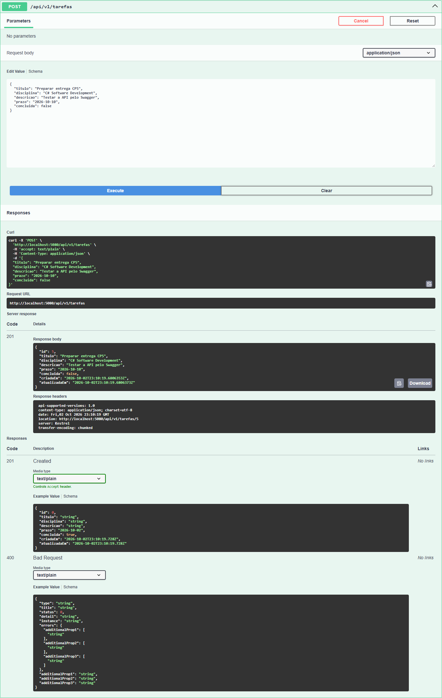

# StudyFlow — API de tarefas de estudo

Projeto CP5 da disciplina **C# Software Development**: API RESTful em **C# / .NET 10**, com **Entity Framework Core 10**, banco **SQLite**, versionamento e Swagger.

## Integrantes

| Nome | RM |
| --- | --- |
| Mateus dos Santos da Silva | 558436 |
| Nickolas Moreno Cardoso | 557132 |
| Andre Giovane de Maria | 556384 |

## Contexto

O StudyFlow ajuda estudantes a organizar atividades por disciplina e prazo. A API permite cadastrar tarefas, consultar pendências, atualizar informações e marcar atividades como concluídas, além de excluir registros. Destina-se a estudantes e a aplicações que precisam centralizar uma agenda acadêmica.

## Tecnologias e organização

- ASP.NET Core Web API com controllers e injeção de dependência.
- EF Core com `StudyFlowContext`, mapeamento explícito da entidade `Tarefa` e operações assíncronas.
- SQLite: banco local `StudyFlow.Api/studyflow.db`, sem instalação de servidor.
- Asp.Versioning: versão 1.0 no segmento da URL (`/api/v1/tarefas`).
- DTOs de entrada e saída, validação de dados e erros no formato Problem Details.
- Swagger UI para documentação e testes interativos.

```text
StudyFlow.Api/
  Controllers/   Rotas HTTP e operações de tarefas
  Data/          DbContext e mapeamento
  Dtos/          Contratos e validações
  Models/        Entidade persistida
  Migrations/    Histórico de alterações do banco
docs/evidencias/ Capturas reais do Swagger e resultados de testes
scripts/         Verificação HTTP e captura de evidências
```

## Como executar localmente

Pré-requisito: **SDK .NET 10**. Execute os comandos a seguir na raiz do repositório:

```bash
dotnet restore
dotnet tool restore
dotnet ef database update --project StudyFlow.Api
dotnet run --project StudyFlow.Api --launch-profile http --urls http://localhost:5080
```

Abra **http://localhost:5080/swagger**. A documentação Swagger é habilitada no ambiente Development, definido pelo perfil `http`. O banco é criado pelo comando de migration e fica na pasta do projeto, independentemente da pasta de execução. Os registros permanecem no disco ao reiniciar a API.

Para compilar:

```bash
dotnet build StudyFlow.slnx
```

## Migration documentada

A migration **InitialCreate**, versionada em `StudyFlow.Api/Migrations`, cria a tabela `Tarefas`, com chave primária inteira autoincrementável, título, disciplina, descrição opcional, prazo, indicador de conclusão e datas de criação/atualização. Também cria o índice `IX_Tarefas_Prazo` para consultas por prazo. O EF Core registra sua aplicação em `__EFMigrationsHistory`.

Comando utilizado para gerar a migration já incluída:

```bash
dotnet ef migrations add InitialCreate --project StudyFlow.Api
```

Para aplicar e consultar o histórico:

```bash
dotnet ef database update --project StudyFlow.Api
dotnet ef migrations list --project StudyFlow.Api
```

Não é necessário gerar novamente `InitialCreate` após clonar. Para uma futura mudança de modelo, gere uma migration com outro nome e execute `database update`.

## Endpoints

Base: `http://localhost:5080`. Todas as rotas de tarefas exigem a versão na URL.

| Método | Rota | Descrição | Respostas |
| --- | --- | --- | --- |
| GET | `/api/v1/tarefas` | Lista tarefas por prazo e ID; aceita `?concluida=true` ou `false` | 200; 400 para filtro inválido |
| GET | `/api/v1/tarefas/{id}` | Consulta uma tarefa | 200, 404 |
| POST | `/api/v1/tarefas` | Cria tarefa e retorna corpo e cabeçalho Location | 201, 400 |
| PUT | `/api/v1/tarefas/{id}` | Substitui os campos editáveis da tarefa | 204, 400, 404 |
| DELETE | `/api/v1/tarefas/{id}` | Remove a tarefa | 204, 404 |

PUT e DELETE bem-sucedidos retornam **204 sem corpo**. Uma lista vazia retorna **200 com `[]`**. IDs inexistentes retornam **404**. Uma versão não suportada no segmento da URL, como `/api/v2/tarefas`, retorna **404**. A API informa as versões suportadas no cabeçalho `api-supported-versions`.

### Corpo para POST e PUT

```json
{
  "titulo": "Estudar Entity Framework Core",
  "disciplina": "C# Software Development",
  "descricao": "Revisar DbContext e migrations",
  "prazo": "2026-10-10",
  "concluida": false
}
```

Título: entre 3 e 120 caracteres, sem aceitar apenas espaços. Disciplina: obrigatória, até 80 caracteres. Descrição: opcional, até 1000 caracteres. Prazo: data válida no formato `AAAA-MM-DD`, diferente da data padrão. Prazos passados são permitidos para registrar atividades atrasadas. O ID e as datas de auditoria são definidos pelo servidor; as datas de auditoria usam UTC.

Para testar no Swagger, expanda a operação, clique em **Try it out**, preencha o corpo ou o ID e clique em **Execute**. Use o ID retornado pelo POST nas operações seguintes.

## Testes e evidências

As imagens abaixo são capturas de requisições executadas no **Swagger UI da própria API**, incluindo URL, código HTTP e resposta:

| Evidência | Arquivo |
| --- | --- |
| Documentação dos endpoints | [Swagger](docs/evidencias/00-swagger.png) |
| POST — criação 201 e Location | [Criação](docs/evidencias/01-post-201.png) |
| GET — listagem 200 | [Listagem](docs/evidencias/02-get-lista-200.png) |
| GET por ID — 200 | [Consulta](docs/evidencias/03-get-id-200.png) |
| PUT — atualização 204 | [Atualização](docs/evidencias/04-put-204.png) |
| POST inválido — 400 | [Validação](docs/evidencias/05-post-invalido-400.png) |
| DELETE — exclusão 204 | [Exclusão](docs/evidencias/06-delete-204.png) |
| GET após exclusão — 404 | [Não encontrado](docs/evidencias/07-get-inexistente-404.png) |



Também há [respostas reais dos testes HTTP](docs/evidencias/resultados.json). O script verifica códigos HTTP, Location, inclusão na listagem, consulta, atualização persistida, filtro por conclusão, exclusão, validação, recursos inexistentes e versão não suportada.

Para repetir a verificação, com a API em execução e **Node.js 18 ou superior** instalado:

```bash
node scripts/test-api.mjs
```

Para gerar novas capturas, é necessário Google Chrome e Playwright:

```bash
npm install
node scripts/capture-swagger.mjs
```

Os scripts criam e excluem seus próprios registros de teste. Node.js e Playwright são opcionais e não são necessários para executar a API.

## Referências e entrega

Estrutura de controllers, DTOs, Swagger e versionamento inspirada no [exemplo de aula APIRESTful](https://github.com/fcrusco/APIRESTful). Neste projeto, a persistência é realizada em SQLite com EF Core e migration versionada.

Entregar o link de **um único repositório do grupo**, com código, migration, README e a pasta de evidências. O repositório deve ser público ou conceder acesso ao professor. O arquivo SQLite é gerado localmente e não é versionado.
